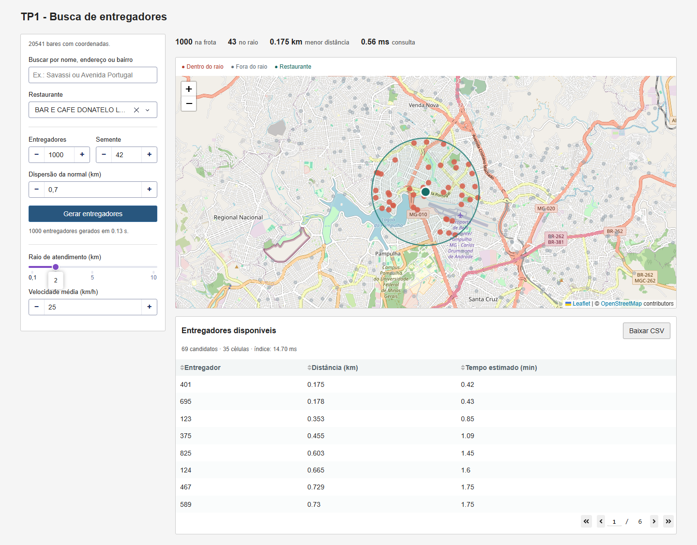
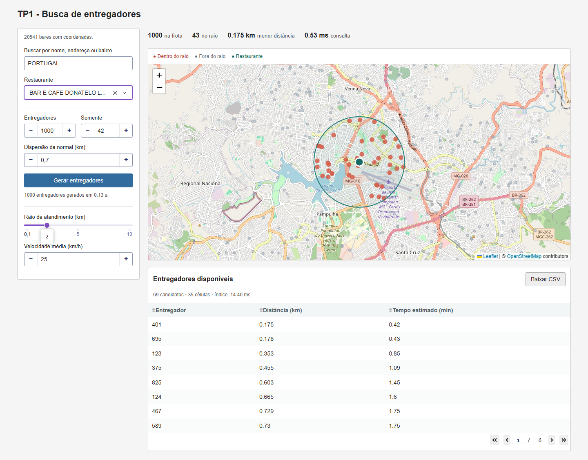
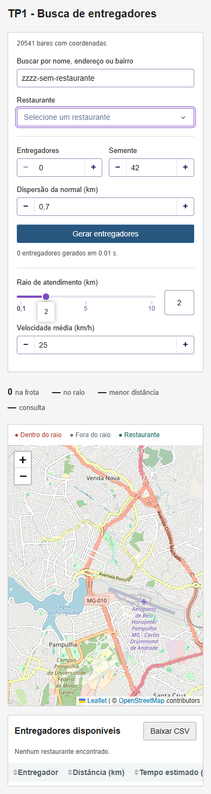

# Indexação geoespacial e busca de entregadores em Belo Horizonte

**Disciplina:** DCC207 — Algoritmos II / UFMG  
**Aluno:** Vitor Faleiro Campos Alves  
**Matrícula:** 2024005920  

## 1. Problema

O sistema simula uma frota de entregadores e consulta os que estão a até um raio escolhido de um restaurante. A indexação espacial reduz o conjunto que precisa passar pelo cálculo de distância. A interface apresenta todos os entregadores, destaca os aprovados e mostra suas distâncias e estimativas de chegada.

As etapas são: carregar restaurantes, gerar a frota segundo demanda, corrigir as posições para vias, codificar cada posição em Geohash, inserir os códigos em uma Trie compacta, consultar células próximas e filtrar os candidatos geometricamente.

## 2. Preparação dos dados

O arquivo original contém **20.859 bares/restaurantes**, mas não possui as coordenadas. Foi utilizada a base complementar [Atividade Econômica da PBH](https://dados.pbh.gov.br/pt_BR/dataset/atividade-economica/resource/108d887f-714b-4969-9a37-b959717bac7a), com **572.224 registros** e uma coluna `GEOMETRIA` no formato `POINT (x y)`.

A [descrição oficial](https://dados.pbh.gov.br/en/dataset/atividade-economica) identifica o sistema **EPSG:31983**, convertido para EPSG:4326 por `pyproj.Transformer`, com `always_xy=True`. O pyproj foi usado somente para transformar o sistema de referência da entrada; não realiza Geohash, busca, filtragem ou projeção em ruas.

Uma inspeção mostrou que os mesmos valores de `_id` identificavam estabelecimentos diferentes nas duas bases. Usar esse campo como chave produziria associações incorretas. O cruzamento utiliza oito campos: CNAE principal, tipo de logradouro, nome do logradouro, número, complemento, bairro, razão social e nome fantasia. A normalização remove diferenças de maiúsculas, acentos e espaços repetidos; não usa aproximação de nomes nem endereços incompletos.

Foram aceitos **20.541 registros (98,48%)**, cada um associado a uma única geometria distinta, e deixados **318 registros pendentes**. O script exibe um resumo no terminal e, com a opção `--relatorios`, salva `importacao.json` e `pendenciasCoordenadas.csv` na pasta indicada. A ausência de correspondência não é preenchida com posição fictícia. A interface e os experimentos usam apenas os bares com coordenadas importadas.

## 3. Geohash e Trie compacta

### 3.1 Codificação

O algoritmo começa com longitude em [-180, 180] e latitude em [-90, 90]. Cada passo divide ao meio um desses intervalos, começando pela longitude e alternando os eixos. O bit é zero na metade inferior e um na superior. Cinco bits formam um caractere no alfabeto `0123456789bcdefghjkmnpqrstuvwxyz`.

Cada entregador recebe um código de oito caracteres, correspondente a 40 bits. Interpretamos os oito níveis do enunciado como oito caracteres de Geohash. Não foi usada biblioteca pronta de Geohash.

### 3.2 Estrutura compacta

Cada nó armazena o trecho de sua aresta de entrada, um dicionário de filhos indexado pelo primeiro caractere e uma lista de IDs terminais. Caminhos sem ramificação são representados por uma única aresta. Quando uma inserção coincide apenas com parte de uma aresta, ela é dividida em um nó intermediário e um sufixo.

A lista de IDs permite múltiplos entregadores com o mesmo código. Na busca, um prefixo que termina no meio de uma aresta também encontra toda a subárvore correspondente. A coleta é iterativa, por pilha, evitando dependência da profundidade de recursão.

### 3.3 Bordas e raio

Consultar apenas a célula do restaurante perderia entregadores do outro lado de uma borda. Também não basta buscar sempre oito vizinhos: um raio grande pode alcançar mais células.

Calculamos um retângulo esférico que contém o círculo da consulta e enumeramos todas as células que o intersectam. A precisão começa em oito e diminui até que a cobertura tenha no máximo 64 células, salvo o limite mínimo de precisão. Em BH, os raios da interface respeitam esse limite. O código também trata a passagem pelo antimeridiano e os polos nos testes.

Essa cobertura produz falsos positivos nos cantos do retângulo, removidos na filtragem. Ela não deve produzir falsos negativos; os testes com busca exaustiva verificam esse requisito. Os candidatos são reunidos em um conjunto de IDs, evitando duplicação.

## 4. Geometria e tempo estimado

A filtragem usa a fórmula de Haversine, com raio médio terrestre de 6.371,0088 km. O critério é distância menor ou igual ao raio, com tolerância numérica de 10⁻⁹ km. Os aprovados são ordenados por distância e depois por ID para desempate.

O tempo exibido é `60 × distânciaKm / velocidadeKmh`. Uma estimativa a velocidade constante em distância geodésica. Não inclui roteamento, sentidos das vias, semáforos, congestionamentos ou o acesso do restaurante à rua.

## 5. Simulação e restrição viária

### 5.1 Distribuição por demanda

Para N entregadores e R restaurantes disponíveis, cada centro recebe `N // R` pontos. O resto é distribuído entre os primeiros centros de uma lista embaralhada por um gerador com semente. Assim, a diferença entre as quantidades de dois centros é no máximo um. Quando N < R, a atribuição é zero ou um por centro.

Os deslocamentos leste/norte são normais independentes, de média zero e desvio padrão escolhido na interface, em um plano equiretangular local de BH. O padrão é 0,7 km. A densidade é maior perto do centro antes da correção viária. O uso de semente torna a execução reproduzível.

### 5.2 Projeção sobre vias

A malha foi obtida do OpenStreetMap via Overpass, em um recorte da região de BH, resultando em **49.062 vias e 226.136 segmentos**. O script registra consulta, endpoint, data e atribuição no cache. São excluídas vias marcadas como privadas/proibidas e categorias incompatíveis com circulação motorizada no filtro adotado. O resultado depende da cobertura e das etiquetas OSM.

Cada segmento AB é convertido para o plano local. Para um ponto P, calculamos `t = ((P − A) · (B − A)) / ||B − A||²`, limitamos t a [0, 1] e obtemos `Q = A + t(B − A)`. Segmentos de comprimento zero são tratados separadamente.

Uma grade de células de 250 m acelera a seleção de segmentos. Cada segmento entra nas células de seu retângulo envolvente. A busca expande camadas em torno do ponto e termina quando a distância até a borda do quadrado já coberto supera a melhor distância encontrada. Qualquer segmento ainda não visitado está fora desse quadrado e não pode melhorar a projeção. Um limite de camadas evita expansão indefinida; nesse caso, é feita a comparação com todos os segmentos.

A projeção é exata para o plano local e a malha carregada, não para toda a superfície terrestre ou todas as ruas existentes. A transformação equiretangular é aproximada, apropriada à escala urbana. Pontos próximos ao limite do recorte podem ser projetados para uma via do recorte mesmo que exista uma via externa mais próxima. Depois da projeção, a distribuição deixa de ser uma normal contínua e passa a se concentrar nas ruas.

## 6. Complexidade

Sejam L ≤ 8 o comprimento do Geohash, N o tamanho da frota, m o comprimento do prefixo, k o número de IDs recuperados, C a quantidade de células, K o número total de candidatos e F o número de aprovados.

| Operação | Tempo | Observação |
|---|---|---|
| Codificar um Geohash | O(L) | Cinco bits por caractere |
| Inserir na Trie | O(L) | Consulta de filhos em dicionário, custo médio constante |
| Construir o índice | O(NL) | Memória O(NL), com L limitado a oito |
| Buscar um prefixo | O(m + k) | Caminhos compactados; coleta proporcional ao resultado |
| Cobrir e consultar células | O(Cm + K) | Inclui codificação dos centros das células |
| Filtrar candidatos | O(K) | Um cálculo de distância por candidato |
| Ordenar aprovados | O(F log F) | Custo adicional à consulta por prefixo |
| Projetar um ponto | O(E) no pior caso | E segmentos; a grade reduz o trabalho na prática |

A geração também embaralha R centros, portanto inclui custo O(R), além das N amostras e projeções. O tempo de consulta medido no núcleo inclui cobertura, busca, filtro e ordenação. O tempo de construção do índice é registrado separadamente.

A interface deliberadamente reconstrói o índice a partir da frota do navegador a cada atualização, para evitar um registro global de sessões. Assim, uma atualização completa também tem custo O(NL), transferência de dados e desenho de N marcadores. A complexidade O(m + k) é da operação de busca por prefixo, não da renderização da página inteira.

## 7. Experimentos

### 7.1 Método

Foram usados os **20.541 restaurantes reais disponíveis**, semente 42, desvio de 0,7 km e frotas de 100, 1.000 e 5.000 entregadores. Três restaurantes foram consultados com raios de 0,5, 2 e 5 km, totalizando **27 cenários**. Cada cenário teve uma consulta de aquecimento e 15 repetições, totalizando **405 consultas verificadas**.

Em cada repetição, os IDs encontrados foram comparados aos de uma varredura exaustiva com Haversine. Todas as comparações foram iguais. Os resultados completos, incluindo mínimos, máximos, geração e indexação, estão em [experimentos.csv](experimentos.csv). As medições são observações desta máquina, não garantias de tempo em outro computador.

### 7.2 Resultados medidos

Consulta no BAR E CAFE DONATELO LTDA:

| Frota | Raio (km) | Candidatos | Aprovados | Consulta, mediana (ms) | Varredura, mediana (ms) |
|---:|---:|---:|---:|---:|---:|
| 100 | 0,5 | 0 | 0 | 1,418 | 0,198 |
| 100 | 2 | 6 | 4 | 0,815 | 0,199 |
| 100 | 5 | 46 | 19 | 0,337 | 0,199 |
| 1.000 | 0,5 | 5 | 4 | 1,561 | 2,025 |
| 1.000 | 2 | 69 | 43 | 1,089 | 1,990 |
| 1.000 | 5 | 423 | 218 | 1,758 | 2,063 |
| 5.000 | 0,5 | 17 | 13 | 1,638 | 11,025 |
| 5.000 | 2 | 352 | 193 | 2,240 | 11,194 |
| 5.000 | 5 | 2.115 | 1.080 | 9,118 | 10,301 |

A geração levou 43,230 / 308,027 / 1.509,738 ms para as três frotas; a construção dos índices levou 3,145 / 35,537 / 197,870 ms, respectivamente. Esses tempos não incluem carregar a malha uma vez no início do script.

Com N pequeno, enumerar células pode custar mais que percorrer todos os pontos. Com 5.000 entregadores e raio de 0,5 km, o índice evita quase todos os cálculos de distância. Já em consultas amplas, o número de candidatos aumenta e a vantagem diminui: em PALLATE com 5.000 entregadores e raio de 5 km, a consulta indexada levou 13,486 ms, contra 10,676 ms da varredura.

A comparação favorece a varredura quanto ao trabalho realizado: sua medição filtra os pontos, mas não ordena nem calcula tempos estimados. Portanto, os valores servem para discutir seletividade e custos, não para afirmar um fator universal de aceleração.

### 7.3 Interface

Realizei algumas capturas para mostrar a interface.

### 7.4 Testes de correção

Os testes automatizados cobrem vetores conhecidos de Geohash, limites de células, divisão de arestas, códigos repetidos, prefixos internos, comparação com busca exaustiva, quatro lados de uma borda, antimeridiano, polos, projeção nos extremos, segmento degenerado, grade versus varredura de segmentos, balanceamento, semente, quantidade zero e consistência dos dados importados.

Os **17 testes automatizados passaram**. O teste visual verificou geração, pesquisa por endereço, substituição da frota, exportação CSV, frota vazia, busca sem resultado e layout móvel, sem erros JavaScript. A execução e os resultados são descritos no README.

## 8. Limitações e melhorias

Os 318 estabelecimentos sem correspondência não participam da geração ou consulta. Uma revisão manual documentada poderia ampliar a cobertura. A qualidade das ruas depende do OSM, e a projeção ignora restrições de sentido e conectividade entre segmentos. O tempo de chegada é apenas uma estimativa geométrica.

Para muitas consultas sobre a mesma frota, seria útil manter o índice em cache por sessão, separando a geração do índice da interação do usuário. Para frotas maiores, o desenho dos pontos também precisaria de agregação ou uma camada de pontos mais eficiente. Essas melhorias não alteram os algoritmos centrais demonstrados aqui.

## 9. Referências

- Enunciado do Trabalho Prático 1, DCC207 — Algoritmos II, UFMG, 2026.
- [PBH — Atividade Econômica](https://dados.pbh.gov.br/en/dataset/atividade-economica).
- [pyproj — Transformer](https://pyproj4.github.io/pyproj/stable/api/transformer.html).
- [Dash — callbacks](https://dash.plotly.com/basic-callbacks).
- [Dash Leaflet](https://www.dash-leaflet.com/).
- [Overpass — bounding boxes](https://dev.overpass-api.de/overpass-doc/en/full_data/bbox.html).
- [OpenStreetMap — licença ODbL e atribuição](https://www.openstreetmap.org/copyright).
